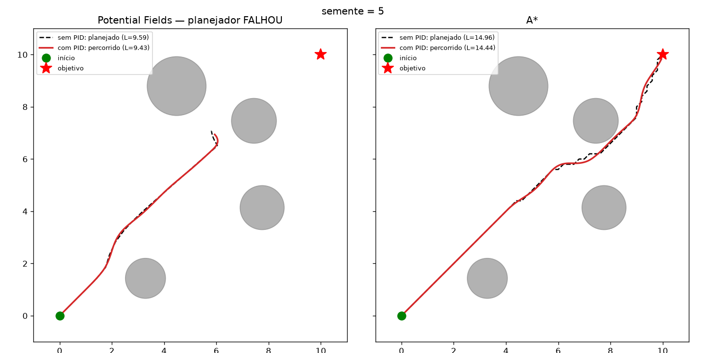

# Planejadores de caminho

Compara dois jeitos de ir do início ao objetivo entre obstáculos circulares aleatórios, e mostra como um robô com inércia, guiado por PID, segue cada caminho.

- **A\*** busca na grade e acha o menor caminho.
- **Campos potenciais** descem um gradiente: o objetivo atrai, os obstáculos repelem. É rápido, mas pode travar num mínimo local.
- **PID** faz o robô obedecer ao caminho planejado, com massa, inércia e limites de motor.

## Ver online

**https://SEU_USUARIO.github.io/planejadores-de-caminho/**

Não precisa instalar nada. Troque qualquer parâmetro e o resultado é recalculado na hora. Cada parâmetro mostra a que algoritmo pertence e uma explicação ao passar o mouse, e pode ser marcado como **aleatório** para ser sorteado a cada execução.



## Rodar o código Python

```bash
pip install -r python/requirements.txt
cd python
python compare_planners.py 2      # compara os dois planejadores (semente 2)
python follow_path.py 2           # adiciona o robô com PID seguindo cada caminho
python potential_fields.py        # só campos potenciais, com o passo a passo das forças
python pid.py                     # PID sozinho: P, PI e PID num controle de velocidade
python interface_planners.py      # interface gráfica (Tkinter)
```

`compare_planners.py` e `follow_path.py` aceitam `--quiet` (silencia o log das forças), e `follow_path.py` aceita também `--sem-janela` (só salva o PNG, sem abrir janela). A semente define o cenário: a mesma semente gera sempre os mesmos obstáculos.

| arquivo | o que faz |
|---|---|
| `astar.py` | A\* em grade 2D, sem interface |
| `potential_fields.py` | campos potenciais: forças, geração de obstáculos, planejamento |
| `pid.py` | classe `PID` e exemplo de controle de velocidade |
| `follow_path.py` | robô com inércia seguindo um caminho com dois PIDs |
| `compare_planners.py` | roda os dois planejadores no mesmo cenário |
| `interface_planners.py` | interface gráfica com parâmetros e sorteio |
| `interface_astar.py` | interface interativa do A\* passo a passo (`rodar.sh` abre) |

## A página web

A página é uma **reescrita em JavaScript** do motor (`web/engine.js`), para rodar no navegador sem servidor. Duas consequências:

- Se você mudar os `.py`, a página não acompanha. Os resultados podem divergir até o `engine.js` ser atualizado.
- O gerador aleatório é outro, então a mesma semente não dá o mesmo cenário no Python e na página.

Para regenerar o `index.html` depois de editar `web/engine.js` ou `web/template.html`:

```bash
python web/build.py
```

## Publicar no GitHub Pages

Em **Settings → Pages**, escolha *Deploy from a branch*, branch `main`, pasta `/ (root)`. O repositório precisa ser público.
